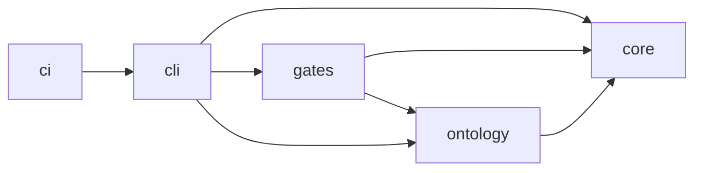

# domain

The words ini uses, then the ontology rendered from the code (`uv run python -m ci domain --write`).

## language

| term | means | is not |
|---|---|---|
| base | the inherited knowledge: foundation, code standard, learnings, skills; copied from ini, improved only there | a starting point to edit |
| harness | `ci/`: the gates, the ratchet and the ontology renderer, run from the tree | an installed package |
| template | the kickoff's placeholder anchors and walking skeleton (`base/skills/kickoff/templates/`) | ini's own anchors |
| copy | a new project: this repository cloned, then started by the kickoff | a fork that tracks ini |
| permeate | an agent bringing part of ini into an existing project on demand: harness first, then compliance | a sync command |
| gate | a deterministic check with a witness it must reject | a lint suggestion |
| witness | files planted in a scratch copy that must turn one gate red | a test of the project |
| finding | one defect: path, line, rule, message, and the function when one is named | a warning |
| ratchet | recorded debt per gate and key that may shrink and never grow | an ignore list |
| ontology | the components, entities and relations read from the code's syntax tree | a diagram drawn by hand |
| wire model | a pydantic model: crosses a boundary, so each field describes itself | any class with fields |
| kickoff | the round that turns a copy into a project and states its objective | a setup wizard |
| harvest | a lesson or skill moving up from a project into ini, or ini moving down into a project | a copy-paste between repos |

<!-- ontology:begin — `python -m ci domain --write` renders this block; a stale block is red -->

## ontology

### ci

The harness: deterministic gates that hold agent-written Python to the base, run from the tree.

No entities: a run layer or a module of pure helpers.

### cli

The run layer: argument parsing and exit codes; it decides nothing.

No entities: a run layer or a module of pure helpers.

### core

The kernel: the project a command runs against, the tools it runs and the findings they report.

| entity | kind | is | has | what it is |
|---|---|---|---|---|
| `IniError` | error |  |  | A refusal: the project is not in a shape ini can judge, and the message says why. |
| `Scope` | vocabulary |  |  | Which of the project's Python directories a check reads. |
| `Settings` | wire |  |  | The `[tool.ini]` table: where the project keeps what the gates read. Every key is optional. |
| `Project` | component |  |  | A repository the gates judge: its root, its settings and every path they name. |
| `Finding` | value |  |  | One defect: where it is, the rule it breaks, what the tool said, and the function if any. |
| `Outcome` | value |  |  | How a tool exited, what it printed to stdout, and what it printed to stderr. |
| `Tool` | component |  |  | A maintained tool, run as `python -m <module>` from the project root in a clean environment. |

### gates

The deterministic gates: a maintained tool's rule where one exists, each one seen to fail.

| entity | kind | is | has | what it is |
|---|---|---|---|---|
| `Domain` | component | Gate |  | Wire fields that describe themselves, and an ontology page that matches the code. |
| `Gate` | component |  |  | A deterministic check: the findings it reports, and the planted defect that proves it. |
| `Skill` | value |  |  | One `SKILL.md`: where it is, what its frontmatter says, and how long it is. |
| `Harness` | component | Gate |  | The instructions agents read: small, consistent, inherited, and started from an objective. |
| `Ceilings` | component |  |  | The ratchet's record: per gate, per finding key, how many findings are tolerated. |
| `Run` | value |  | Scope | One ruff invocation: the scope it reads, the rules it selects, the settings it overrides. |
| `Ruff` | component |  |  | ruff, asked for findings in JSON and decoded once. |
| `RuffGate` | component | Gate |  | A gate that is a set of ruff runs. |
| `Lint` | component | RuffGate |  | Defects, unclear code and layout. |
| `Annotations` | component | RuffGate |  | Every function states what it takes and returns; `Any` never appears in a signature. A test |
| `Docs` | component | RuffGate |  | Self-commented code: modules, packages and classes say what they are; no commented-out code. |
| `Complexity` | component | RuffGate |  | A function over budget wants its data as a table and its code as the interpreter. |
| `Surface` | component | RuffGate |  | Shapes that are refused outright: dict-as-record, executable strings, executable data. |
| `Replica` | component |  |  | A scratch copy of the project's gate inputs, where a witness can be planted safely. |
| `Runner` | component |  |  | The gates over one project: check, prove, record, adopt, describe. |
| `Suite` | value |  | Outcome | One run of the behaviour suite under coverage: its exit, and the share of each function run. |
| `Session` | component |  |  | The shared state of one gate run over one project. |
| `Module` | value |  |  | One module's syntax tree, and whether it is domain code: in the package, outside `cli/`. |
| `Shape` | component | Gate |  | Classes for concepts, a thin run layer, and no file outside the gates' sight. |
| `Behaviour` | component | Gate |  | The suite that drives the code through its public surface; red is red, no ratchet. |
| `Crap` | component | Gate |  | Change risk: complexity the suite does not run. |
| `Types` | component | Gate |  | ty over every scope: wrong types and unguarded `None` are defects, never style. |
| `Deadcode` | component | Gate |  | vulture over production code; tests excluded, because a helper only its test calls is dead. |
| `Duplication` | component | Gate |  | pylint's `symilar` over production code: a block copied twice is a missing abstraction. |

### ontology

The domain read from the code: packages, entities and their relations — rendered, never drawn.

| entity | kind | is | has | what it is |
|---|---|---|---|---|
| `Kind` | vocabulary |  |  | The role a class plays in the domain, read from what it extends or how it is decorated. |
| `Attribute` | value |  |  | An annotated attribute declared in a class body, and how it says what it is. |
| `Entity` | value |  | Attribute, Kind | A public class: where it lives, what it says it is, its kind, parents and attributes. |
| `Package` | value |  | Entity | A component: one sub-package of the project, the role its `__init__` states, its entities. |
| `Ontology` | value |  | Package | The domain as the code declares it: components, the imports between them, their entities. |
| `Declaration` | value |  |  | A class statement as written, with the module facts the lineage pass needs. |
| `Lineage` | component |  |  | Resolve a class's kind and config through its bases: project classes first, then roots. |
| `Reader` | component |  |  | Read the project's package — modules, classes, imports — into an `Ontology`. |
| `Renderer` | component |  |  | Print the ontology: the component graph, then one entity table per component. |
| `Page` | component |  |  | The domain page: hand-written text around the one block the renderer owns. |

<!-- ontology:end -->
